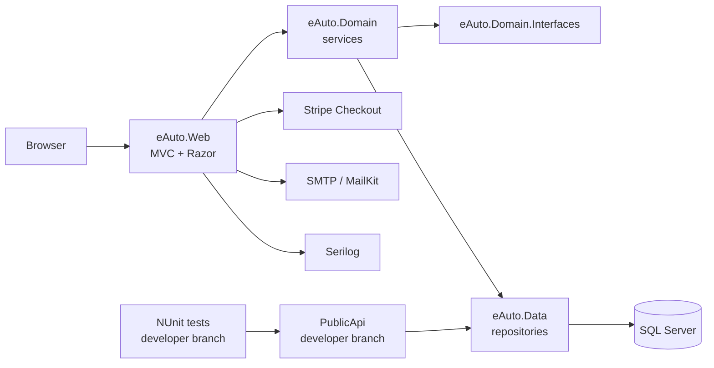

<p align="center">
  
</p>

<h1 align="center">eAuto Center</h1>

<p align="center">
  A car marketplace and engine-oil store built with ASP.NET Core MVC, EF Core and SQL Server.
</p>

<p align="center">
  
  
  
  
  
  
  
</p>

<p align="center">
  <b>30 pull requests</b> · <b>214 commits on main</b> · <b>February – June 2023</b>
</p>

---

## Overview

**eAuto Center** is a full-stack pet project that combines two scenarios in one application:

- a **car showroom** with a filtered catalog, car details and callback requests;
- a small **e-commerce store** for engine oils with a shopping cart, Stripe checkout and order management.

The project was built incrementally: from CRUD screens for reference data and a layered backend to ASP.NET Core Identity, role-based areas, a shopping cart, Stripe payments, email notifications, order processing and a public read-only API.

> **Branch status**
>
> `main` contains the MVC application through PR **#27** (June 15, 2023).
>
> The `developer` branch contains three additional merged PRs: the single-database refactor (**#28**), the read-only Public API (**#29**) and NUnit tests (**#30**). Sections marked **(developer branch)** are not part of `main` yet.

---

## Features

### Customer storefront

- **Car catalog** with filters by brand, model, generation, body type, drive type, transmission and engine type.
- **Cascading AJAX filters**: brand → model → generation dropdowns are loaded on demand.
- **Car details page** with price, year, mileage, engine specs, body/drive/transmission data, image and HTML description.
- **Engine-oil catalog** with product brand, viscosity, composition, volume and price.
- **Shopping cart** stored in SQL Server per authenticated user, with quantity controls and a session-based item counter in the header.
- **Checkout** with an order summary, Stripe Checkout session, confirmation page, cart cleanup and email notification.
- **“Call me” request** form that works for both anonymous visitors and signed-in customers.
- **Customer account**: registration, login, profile management, password change, email confirmation and Facebook external login (when configured).
- **Order history**: customers can view their own orders and their current statuses.

### Admin back office

- **Catalog management**: CRUD for body types, brands, models, generations, transmissions, drive types, cars and engine oils.
- **Image management**: upload with GUID-based file names, replace and delete old images.
- **Order management**: filter by status, edit customer/shipping data, start processing, ship, cancel with a Stripe refund, and store tracking number/carrier.
- **Callback request management**: start processing, complete or reject car inquiries.
- **Role-based access**: the Admin role protects catalog CRUD, Admin and Employee can process orders, and customers only see their own orders.
- **Admin panel**: off-canvas navigation available from the main layout.

### Platform

- **Layered architecture**: `Web → Domain → Data`, with interfaces in separate projects and a dedicated DI composition root.
- **EF Core Code First**: migrations for catalog/commerce and Identity; migrations and demo data are applied automatically at startup.
- **Repository + service layer**: generic repository, domain models with persistence behavior, and generic domain exceptions.
- **ASP.NET Core Identity** with an extended `ApplicationUser` (first name, last name, phone, street address, city).
- **Serilog logging** to console and daily rolling files through a custom `IAppLogger<T>` adapter.
- **Error handling**: controller-level exception handling, a central error page, Toastr notifications and SweetAlert2 confirmations.
- **Bootstrap 5 Slate UI** with a responsive layout, Bootstrap Icons and TinyMCE for rich-text descriptions.
- **Email notifications** via MailKit/MimeKit and SMTP.
- **Public API** *(developer branch)*: read-only cars endpoints with Swagger and Serilog.
- **Automated tests** *(developer branch)*: NUnit + EF Core InMemory for the cars API service and controller.

---

## Tech stack

| Area | Technology |
|---|---|
| Backend | C#, ASP.NET Core MVC (.NET 7) |
| Data access | EF Core 7, SQL Server, Code First migrations |
| Authentication | ASP.NET Core Identity, cookie authentication, roles, Facebook OAuth |
| Payments | Stripe Checkout, Stripe refunds |
| Email | MailKit, MimeKit, SMTP |
| Logging | Serilog (console + rolling file), custom `IAppLogger<T>` adapter |
| Frontend | Razor views, Bootstrap 5 (Slate), jQuery, AJAX, Toastr, SweetAlert2, TinyMCE |
| Public API *(developer branch)* | ASP.NET Core Web API, Swagger/OpenAPI, Serilog |
| Tests *(developer branch)* | NUnit, NUnit3TestAdapter, EF Core InMemory, coverlet |
| Tooling | .NET CLI, `dotnet-ef` local tool, Visual Studio 2022 |

---

## Architecture

### Layers

| Project | Responsibility |
|---|---|
| `eAuto.Web` | ASP.NET Core MVC application, Razor views, areas (`Admin`, `Customer`, `Identity`), view components and web utilities. |
| `eAuto.Domain` | Business services and domain models. |
| `eAuto.Domain.Interfaces` | Domain/service abstractions, enums and domain exceptions. |
| `eAuto.Data` | EF Core contexts, repositories, migrations, Identity setup, email sender and logging adapter. |
| `eAuto.Data.Interfaces` | Data models, repository interfaces, enums and data exceptions. |
| `DiConfigurator` | Composition root that registers services, contexts and repositories. |
| `PublicApi` *(developer branch)* | Read-only Web API for cars. |
| `tests/publi-api-tests` *(developer branch)* | NUnit tests for the public API. |

### Request flow



`eAuto.Web` depends on domain abstractions; `DiConfigurator` wires concrete implementations from `eAuto.Data` and `eAuto.Domain`. Controllers work with view models, services and domain interfaces rather than EF Core directly.

---

## Repository structure

```text
eAuto-center/
├── src/
│   ├── eAuto.Web/                 # MVC app, areas, views, view components, wwwroot
│   ├── eAuto.Domain/              # domain models and business services
│   ├── eAuto.Domain.Interfaces/   # service/domain contracts and exceptions
│   ├── eAuto.Data/                # EF Core contexts, repositories, migrations, identity
│   ├── eAuto.Data.Interfaces/     # data models, repository contracts, enums
│   ├── DiConfigurator/            # dependency injection composition root
│   ├── PublicApi/                 # read-only Web API (developer branch)
│   └── ...
├── tests/
│   └── publi-api-tests/           # NUnit tests (developer branch)
├── eAuto-center.sln
└── README.md
```

### Main entities

| Domain | Entities |
|---|---|
| Catalog | `BodyType`, `Brand`, `Model`, `Generation`, `DriveType`, `Transmission`, `EngineType`, `Car` |
| Store | `ProductBrand`, `MotorOil`, `ShoppingCart`, `OrderHeader`, `OrderDetails`, `OrderCar` |
| Identity | `ApplicationUser` and the standard ASP.NET Core Identity tables |

`OrderCar` represents a callback request / car inquiry, not a paid car purchase.

On `main`, catalog/commerce and Identity use separate contexts and databases (`eAutoDataDB` and `eAutoIdentityDB`). The `developer` branch refactors this into a single database.

---

## Getting started

### Prerequisites

- [.NET SDK 7.0](https://dotnet.microsoft.com/download/dotnet/7.0) (the solution was built with SDK `7.0.410`)
- SQL Server 2019+ (Express, Developer, LocalDB or a SQL Server container)
- Optional: a Stripe test account for checkout
- Optional: SMTP credentials for email notifications
- Optional: a Facebook OAuth app for external login

### 1. Clone the repository

```bash
git clone https://github.com/EVezhnovets/eAuto-center.git
cd eAuto-center
```

### 2. Configure the application

For local development, update `src/eAuto.Web/appsettings.Development.json`:

```json
{
  "ConnectionStrings": {
    "eAutoCatalogConnection": "Server=localhost;Database=eAutoDataDB;Trusted_Connection=True;TrustServerCertificate=True;MultipleActiveResultSets=true",
    "eAutoIdentityConnection": "Server=localhost;Database=eAutoIdentityDB;Trusted_Connection=True;TrustServerCertificate=True;MultipleActiveResultSets=true"
  },
  "Stripe": {
    "SecretKey": "sk_test_your_key"
  }
}
```

Alternatively, keep secrets out of the repository with user-secrets:

```bash
dotnet user-secrets init --project src/eAuto.Web
dotnet user-secrets set "ConnectionStrings:eAutoCatalogConnection" "..." --project src/eAuto.Web
dotnet user-secrets set "ConnectionStrings:eAutoIdentityConnection" "..." --project src/eAuto.Web
dotnet user-secrets set "Stripe:SecretKey" "sk_test_..." --project src/eAuto.Web
```

> The SMTP credentials are currently hard-coded in `src/eAuto.Data/EmailSender.cs`. Replace them with your own values, or refactor the sender to read from configuration before using email functionality.

### 3. Build and run

```bash
dotnet restore
dotnet build
dotnet run --project src/eAuto.Web
```

The default development URLs are:

- HTTP: `http://localhost:5247`
- HTTPS: `https://localhost:7261`

The root route opens the customer car catalog (`Customer/CarsCatalog/Index`).

### 4. First start

On startup the application:

1. applies pending EF Core migrations for the catalog and Identity contexts;
2. seeds reference data and demo cars/engine oils;
3. creates the `Admin`, `Customer` and `Employee` roles and a default administrator account.

A reachable SQL Server instance is required. If the database is unavailable, startup logs the migration error and the application continues without a working database.

> The seeded administrator credentials are defined in `src/eAuto.Data/Identity/DbInitializer.cs`. Change them before exposing the application publicly.

### Optional integrations

| Integration | What to configure |
|---|---|
| Stripe | Set `Stripe:SecretKey` in configuration. The checkout uses Stripe test mode; the test card `4242 4242 4242 4242` works with any future expiry date and CVC. |
| Email | Replace the hard-coded SMTP host, login and password in `EmailSender.cs`, or move them to configuration. |
| Facebook login | `Program.cs` registers Facebook authentication with empty options. Set `AppId` and `AppSecret` (preferably from configuration/user-secrets) and remove the comments around the options. |

---

## Public API (developer branch)

The read-only API lives on the `developer` branch:

```bash
git checkout developer
dotnet run --project src/PublicApi
```

| Method | Endpoint | Description |
|---|---|---|
| `GET` | `/api/Cars/get-all-cars` | Returns all cars with brand, model, generation, body type, drive type and transmission data. |
| `GET` | `/api/Cars/get-car-by-id/{id}` | Returns one car by id, or a `400` response with `Car not found`. |

Swagger UI is enabled in the Development environment. The API currently has no authentication/JWT and returns data models directly; DTOs, versioning and CORS are on the roadmap.

---

## Tests (developer branch)

```bash
git checkout developer
dotnet test tests/publi-api-tests/publi-api-tests.csproj
```

The test project contains **6 NUnit tests** covering the cars API service and controller. It uses EF Core InMemory with a seed helper, so no SQL Server instance is required.

---

## Development history

The project was built in **30 pull requests** and **214 commits on `main`** between February and June 2023. `main` stops at PR #27; PRs #28–#30 were merged into `developer`.

<details>
<summary><b>All pull requests</b></summary>

| # | Merged | Scope |
|---:|---|---|
| 1 | 2023-03-20 | Project architecture, layered solution, Body Type CRUD |
| 2 | 2023-03-20 | Brand CRUD |
| 3 | 2023-03-21 | Model CRUD |
| 4 | 2023-03-21 | Generation CRUD |
| 5 | 2023-03-21 | Transmission CRUD |
| 6 | 2023-03-21 | Drive Type CRUD |
| 7 | 2023-03-25 | Engine CRUD (later replaced by engine types) |
| 8 | 2023-03-26 | Car CRUD and car view models |
| 9 | 2023-03-26 | Areas (`Admin` / `Customer`) and project structure refactor |
| 10 | 2023-03-26 | Image manager: upload, replace and delete images |
| 11 | 2023-03-29 | Serilog logging and `IAppLogger<T>` adapter |
| 12 | 2023-03-30 | Customer catalog, car details and default routing |
| 13 | 2023-04-02 | ASP.NET Core Identity, roles and extended user profile |
| 14 | 2023-04-18 | AJAX filters, seed data and engine-type refactor |
| 15 | 2023-04-22 | Engine oils, product brands and the oils storefront |
| 16 | 2023-04-30 | Shopping cart: entity, service, controller and views |
| 17 | 2023-05-01 | File logging |
| 18 | 2023-05-03 | Context/migrations fixes and SQL retry policy |
| 19 | 2023-05-03 | Merge of accumulated developer changes |
| 20 | 2023-05-29 | Order header/details and checkout summary |
| 21 | 2023-06-02 | Stripe Checkout and order confirmation |
| 22 | 2023-06-05 | Admin order list and details |
| 23 | 2023-06-06 | Order statuses, roles and Stripe refunds |
| 24 | 2023-06-10 | MailKit email sender and order email |
| 25 | 2023-06-13 | Session cart counter and ShoppingCart view component |
| 26 | 2023-06-14 | Facebook external login and Identity `DbInitializer` |
| 27 | 2023-06-15 | Callback requests / `OrderCar` and admin processing |
| 28 | 2023-06-19 | Single database/context refactor *(developer)* |
| 29 | 2023-06-28 | Public cars API, Swagger and Serilog *(developer)* |
| 30 | 2023-06-29 | NUnit test project for the public API *(developer)* |

</details>

---

## Roadmap

- [ ] Merge `developer` into `main`.
- [ ] Move connection strings, SMTP, Stripe and OAuth credentials to user-secrets or Azure Key Vault.
- [ ] Add CI (build + tests) and a Docker Compose setup with SQL Server.
- [ ] Add pagination to catalogs and admin tables.
- [ ] Add CORS and JWT authentication for the public API.
- [ ] Introduce request/response DTOs and API versioning.
- [ ] Add dark/light theme and localization (the code already defines `en-US` and `be-BY` cultures).
- [ ] Add full-text search (Elasticsearch or SQL Server full-text search).
- [ ] Add car comparison.
- [ ] Add static analysis and increase test coverage.
- [ ] Add admin user management.
- [ ] Add screenshots, a live demo link and a license.

---

## Current limitations

- Currency is hard-coded to **USD** in the Stripe Checkout session.
- Catalogs and admin tables have **no pagination** yet.
- Email and Facebook login need manual configuration.
- The public API and automated tests are only on the `developer` branch.
- There is no CI/CD pipeline, Docker setup or deployment configuration in the repository.
- The application uses **two databases/contexts** on `main`; the single-database refactor is on `developer`.

---

## Security checklist

Before publishing a deployment:

- [ ] Rotate any development credentials that have been committed to the repository.
- [ ] Store connection strings and SMTP/OAuth/Stripe credentials in user-secrets or a secret manager.
- [ ] Change the seeded administrator password.
- [ ] Replace the TinyMCE demo API key used in `_Layout.cshtml`.
- [ ] Enable HTTPS/HSTS and review the cookie and session settings.
- [ ] Add rate limiting and validation to public forms and API endpoints.

---

## Screenshots

Screenshots are not included yet. A good next step is to add images for:

- the car catalog and filter panel;
- car details;
- the engine-oil catalog;
- the shopping cart and Stripe checkout;
- the admin order management screen;
- Swagger UI for the public API.

---

## License

No license file is included in the repository. The project is shared for portfolio and educational purposes. Add a `LICENSE` file (for example, MIT) if you want others to reuse the code.

---

## Contact

**Eugene Vezhnovets**

- GitHub: [@EVezhnovets](https://github.com/EVezhnovets)
- Repository: [EVezhnovets/eAuto-center](https://github.com/EVezhnovets/eAuto-center)

---

<p align="center">
  Built as a pet project to practice ASP.NET Core MVC, EF Core, Identity, Stripe and layered application design.
</p>
